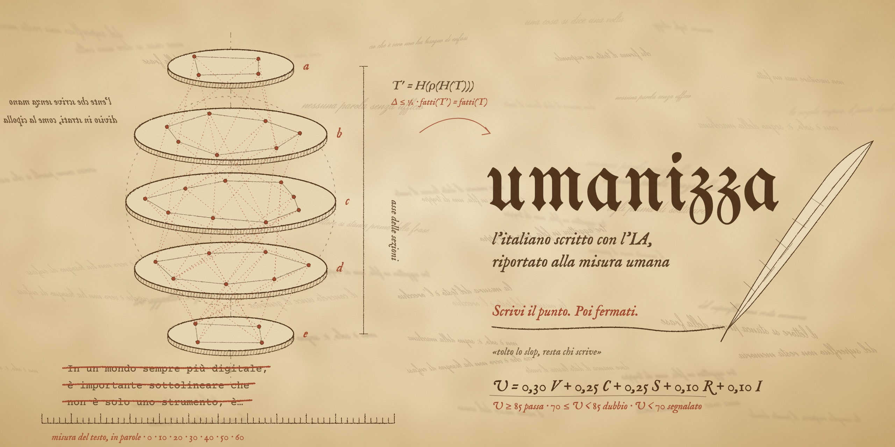
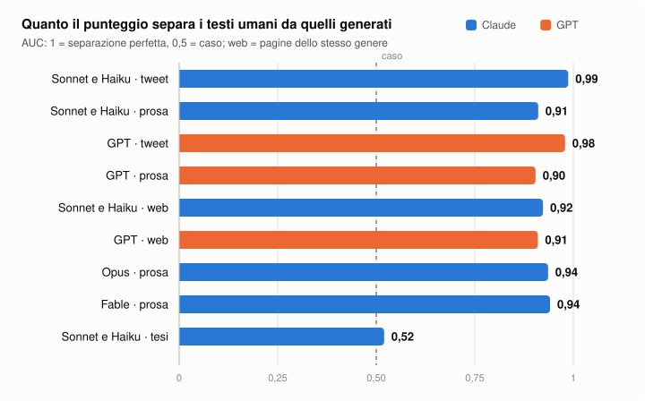
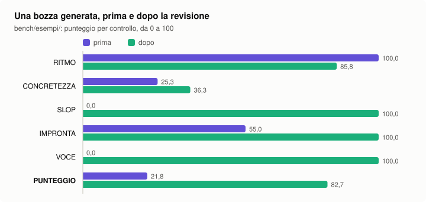
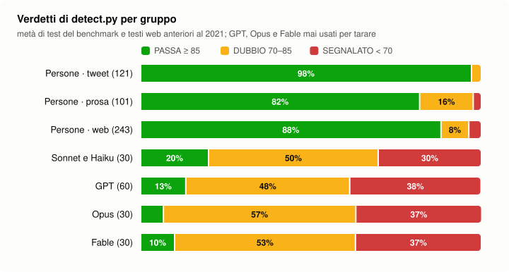
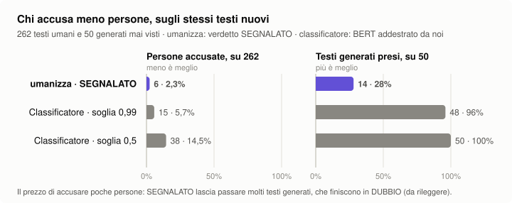

# umanizza

<p align="center"></p>

[](https://github.com/dagoSte/umanizza/actions/workflows/test.yml) [](#indice-di-affidabilità)

Humanizer per testi in italiano generati con l'IA.

Una skill per Claude Code e Codex, che si usa anche su claude.ai e Claude Desktop. Trova e toglie i segni della scrittura automatica in italiano, come «in un mondo sempre più digitale», «è importante sottolineare che», «a 360 gradi», i titoli Con Tutte Le Maiuscole e le chiuse «E voi? Fatemelo sapere nei commenti», poi misura il risultato. Solo Python standard, nessuna rete.

## In breve

| Domanda | Risposta | In numeri |
|---|---|---|
| Distingue i testi generati da quelli scritti da persone? | **Sì** | 9 volte su 10 in prosa, quasi sempre nei tweet, con Claude e con GPT |
| Pulisce senza rovinare i testi umani? | **Sì** | 9 sostituzioni su 444 testi umani, tutte corrette |
| Funziona in Claude Code e in Codex? | **Sì** | provata in entrambi |
| Il testo riscritto sembra più umano? | **Sì** | 16,5 coppie su 20 alla cieca |
| Il testo riscritto si legge meglio? | **Non sempre** | con Claude che riscrive, preferito da 13 a 19 volte su 20 sui testi di Claude e da 5 a 11 sui testi di GPT; in Codex conviene usarla per misurare e pulire |
| Funziona su tesi e articoli accademici? | **Solo per la pulizia** | lì il punteggio non è affidabile |
| Serve a superare i detector esterni? | **No** | due riscritture che per umanizza passano restano «IA al 100%» per GPTZero e per Pangram |
| I detector esterni sono affidabili? | **Sul testo generato sì, sul testo umano formale no** | un detector addestrato da noi prende 48 testi generati nuovi su 50, ma accusa 15 testi umani nuovi su 262 |

<picture>
  <source media="(prefers-color-scheme: dark)" srcset="docs/grafici/auc-scuro.svg">
  
</picture>

## Indice di affidabilità

**7,88 su 10.** Calcolato da `python3 bench/indice.py` sui soli dati di verifica, con una formula fissata prima del calcolo.

| Componente | Cosa misura | Valore | Peso |
|---|---|---|---|
| Riconoscimento | separazione media su 12 confronti (prosa, tweet, web × 4 modelli) | 0,89 | 30% |
| Falsi allarmi evitati | testi umani non SEGNALATI, su 464 | 0,97 | 10% |
| Copertura dei generi | generi con separazione ≥ 0,80 (le tesi no) | 0,75 | 10% |
| Pulizia sicura | sostituzioni corrette, 9 su 9 | 1,00 | 15% |
| Fedeltà ai fatti | riscritture senza fatti persi o inventati, 20 su 20 | 1,00 | 15% |
| Leggibilità della riscrittura | preferenza per il riscritto alla cieca, 25 su 40 | 0,25 | 20% |

**Un 10 è impossibile**, per umanizza e per qualunque strumento che giudichi un testo dallo stile. Anche le persone scrivono testi piatti e formali, e i modelli migliori a volte scrivono come le persone: le due cose si sovrappongono, e nessuna soglia le separa senza errori. Lo abbiamo misurato: un classificatore neurale addestrato su 930 testi, costruito come i detector commerciali, riconosce il 96% dei testi generati mai visti ma accusa il 5,7% dei testi umani mai visti, e alzare la soglia non basta (vedi «Limiti dei detector»). Un test controlla che il valore qui sopra sia quello calcolato.

La componente più bassa è la leggibilità. Tre prove fatte per alzarla, con criteri fissati prima, non hanno retto e non sono entrate nella skill: far riscrivere a Claude anche i testi di GPT, cambiare le regole di riscrittura, guidare la riscrittura con un profilo di genere costruito su testi umani. L'indice resta quello della prima lettura alla cieca.

## Installazione

**Claude Code** (consigliato):

```
/plugin marketplace add dagoSte/umanizza
/plugin install umanizza@umanizza
```

**Copia manuale**, per Claude Code o Codex:

```
git clone https://github.com/dagoSte/umanizza.git
cp -r umanizza/skills/umanizza ~/.claude/skills/     # Claude Code
cp -r umanizza/skills/umanizza ~/.codex/skills/      # Codex
```

**claude.ai e Claude Desktop**: carica `umanizza-skill.zip` dalla [release](https://github.com/dagoSte/umanizza/releases/latest) nelle impostazioni delle skill, con l'esecuzione di codice attiva.

La skill si attiva da sola quando chiedi di umanizzare o rivedere un testo in italiano; in Claude Code anche con `/umanizza` (`/umanizza:umanizza` se installata come plugin). Requisiti: Python 3.9 o successivo.

Facoltativo: copia `skills/umanizza/voce-modello.md` in `~/.claude/umanizza/voce.md` e compilalo con il tuo modo di scrivere.

## Come funziona

```
bozza ──▶ detect.py ──▶ humanize.py ──▶ riscrittura ──▶ humanize.py ──▶ detect.py prima dopo
          punteggio      pulizia e       delle frasi      pulizia di      differenza e
          iniziale       segnalazioni    segnalate        controllo       fedeltà
```

1. **Misura**: punteggio da 0 a 100 su cinque controlli.
2. **Pulizia**: `humanize.py` corregge solo ciò che non cambia il senso e segnala il resto, con una domanda per chi riscrive.
3. **Riscrittura**: l'assistente riscrive le frasi segnalate. Non inventa dati: se manca un numero lascia `{{il tuo numero}}`.
4. **Verifica**: nuovo punteggio e controllo che nessun numero, nome o citazione sia sparito o comparso.

**La pulizia** toglie i caratteri invisibili, sistema la tipografia (lineette usate come inciso, virgolette curve) e applica 42 sostituzioni sicure come «al fine di» → «per». Non tocca codice, URL, email, menzioni, hashtag, dialoghi né intestazioni dei comunicati.

```
MODIFICATO
  r1   lessico    'In un mondo sempre più digitale,' → '(tolto)'  (apertura)
  r3   lessico    'Al fine di' → 'Per'  (burocratese)

DA RISCRIVERE A MANO (non toccato)
  r3   tell     «Non è solo una tecnologia, è»
                ↳ Non è solo X, è Y: contrasto gonfiato
                ? Qualcuno ha davvero detto che è «solo X»? Se no, di' Y e basta.
```

**Il punteggio** pesa cinque controlli:

| Controllo | Cosa misura | Peso |
|---|---|---|
| VOCE | strutture tipiche: *non è solo X, è Y*, triadi, *Primo/Secondo/Terzo*, chiuse che chiedono commenti | 0,30 |
| CONCRETEZZA | numeri, nomi, date, unità ogni 100 parole | 0,25 |
| SLOP | voci del lessico che distinguono, pesate | 0,25 |
| RITMO | variazione della lunghezza delle frasi | 0,10 |
| IMPRONTA | caratteri invisibili | 0,10 |

Verdetto: **PASSA** da 85, **DUBBIO** da 70 a 85, **SEGNALATO** sotto 70. Esce con codice 1 se SEGNALATO, quindi si usa anche in un hook o in CI.

<picture>
  <source media="(prefers-color-scheme: dark)" srcset="docs/grafici/prima-dopo-scuro.svg">
  
</picture>

L'esempio resta in DUBBIO per CONCRETEZZA: per salire servono dati veri di chi scrive, che la skill non inventa.

### La formula

$$U = 0{,}30\,V + 0{,}25\,C + 0{,}25\,S + 0{,}10\,R + 0{,}10\,I$$

$$V = \max\Big(0,\ 100 - 2800\,\frac{\sum_t w_t}{\max(n,100)}\Big) \qquad C = \min\Big(100,\ \frac{100}{7}\cdot\frac{100\,m}{\max(n,30)}\Big)$$

$$S = \max\Big(0,\ 100 - 22\cdot\frac{100\sum_v w_v}{\max(n,60)}\Big) \qquad R = \min\Big(100,\ 100\cdot\frac{\sigma(\ell)/\mu(\ell)}{0{,}55}\Big) \qquad I = 100 - 45\,[g>0] - \min(10,\ 2s)$$

$n$ parole, $w_t$ pesi delle strutture trovate, $m$ dati concreti, $w_v$ pesi delle voci del lessico, $\ell$ lunghezze delle frasi, $g$ caratteri invisibili, $s$ spazi speciali. La trasformazione è $T' = H(\rho(H(T)))$: pulizia, riscrittura, pulizia, con al massimo metà delle parole cambiate e gli stessi fatti dell'originale.

### Altri usi

- **Testi nuovi**: prima di scrivere, l'assistente legge `prima-di-scrivere.md`, un brief che evita lo slop già in partenza.
- **Tesi e articoli**: `--genere accademico` esclude citazioni, rimandi di pagina ed elenchi di fatti.
- **File Word**: `docx.py` applica le modifiche come revisioni tracciate, da accettare o rifiutare in Word, e verifica che note e fatti restino al loro posto.
- **Taratura personale**: `taratura.py` confronta i tuoi post (export di Threads, Instagram, Facebook, LinkedIn, X) con testi di Claude sugli stessi argomenti e salva soglie su misura.

## Comandi

I percorsi sono relativi a `skills/umanizza/`.

```
python3 humanize.py bozza.txt --report -o pulito.txt      # pulizia e segnalazioni
python3 detect.py bozza.txt                               # punteggio
python3 detect.py prima.txt dopo.txt                      # differenza e fedeltà
python3 detect.py bozza.txt --dettagli                    # ogni voce e struttura trovata
python3 detect.py tesi.txt --genere accademico            # modalità accademica
python3 docx.py estrai tesi.docx --note -o tesi.txt       # testo di un file Word
python3 docx.py applica tesi.docx modifiche.json -o tesi_revisioni.docx
python3 taratura.py importa meta.zip Shares.csv tweets.js --cartella tara/
```

## Validazione

Ogni numero viene da una prova con criteri fissati prima, su dati mai usati per tarare. Resoconto completo in [docs/validazione.md](docs/validazione.md).

| Prova | Risultato |
|---|---|
| 444 testi umani contro testi di Claude | AUC 0,99 nei tweet, 0,91 in prosa |
| 485 pagine web umane dello stesso genere, 2013-2020 | AUC 0,90-0,92 |
| 60 testi di GPT | AUC 0,98 nei tweet, 0,90 in prosa |
| 60 testi di Claude Opus e Fable | AUC 0,94 in prosa |
| Sei letture alla cieca delle riscritture di Claude | preferite da 13 a 19 volte su 20 sui testi di Claude, da 5 a 11 sui testi di GPT |
| Due riscritture passate su detector esterni | «IA al 100%» prima e dopo |
| Classificatore addestrato da noi (BERT italiano, 930 testi) | riconosce il 96% dei generati nuovi, accusa il 5,7% degli umani nuovi |

<picture>
  <source media="(prefers-color-scheme: dark)" srcset="docs/grafici/verdetti-scuro.svg">
  
</picture>

## Limiti dei detector

I detector seri, come Pangram, sono classificatori addestrati su milioni di coppie di testi umani e generati. Ne abbiamo costruito uno piccolo, con criteri fissati prima, per vedere cosa si replica ([bench/classificatore](bench/classificatore/LEGGIMI.md)).

- **Riconoscono bene il testo generato**: il nostro prende 48 testi generati nuovi su 50, anche di modelli che non ha mai visto, e la riscrittura di umanizza non sposta il suo punteggio di un millesimo.
- **Sbagliano sul testo umano formale**: accusa 15 testi umani nuovi su 262, e 7 brani di prosa giuridica e tradotta su 31 (in parte già presenti nei dati del benchmark: l'esito non cambia senza di loro). Alzare la soglia riduce le accuse ma non le elimina. La letteratura trova lo stesso, in scala più grande: tesi, saggi di non madrelingua e generi mai visti sono i più accusati.
- **In italiano sono poco verificati**: Turnitin non lo supporta, e le prove indipendenti riguardano quasi solo notizie.

Quindi un «IA» su un testo davvero generato è attendibile; un «IA» su un testo umano formale non prova nulla.

**La soglia di umanizza è la migliore fra quelle misurate per non accusare le persone.** Sugli stessi testi nuovi SEGNALATO accusa 6 testi umani su 262 (2,3%) e nessun brano di prosa formale, contro 15 e 7 del classificatore. Il prezzo è voluto: SEGNALATO prende solo 14 testi generati nuovi su 50, perché umanizza preferisce lasciar passare un testo generato piuttosto che accusare una persona. I casi incerti finiscono in DUBBIO, che chiede di rileggere e non accusa. Numeri e fonti in [docs/validazione.md](docs/validazione.md#limiti-dei-detector).

<picture>
  <source media="(prefers-color-scheme: dark)" srcset="docs/grafici/soglie-scuro.svg">
  
</picture>

## Limiti

- **Il punteggio descrive lo stile, non l'autore**: anche un testo umano può finire in DUBBIO o, raramente, SEGNALATO.
- **Modelli misurati**: Claude e GPT; Gemini e altri no.
- **Nessun watermark rimosso** e nessuna ottimizzazione contro i detector.
- **PASSA non vuol dire «non rilevabile»**: nei due casi provati, un testo riscritto che per umanizza passa (86 e 87 su 100) resta «IA al 100%» per Pangram e per GPTZero.
- **In una tesi** l'uso dell'IA va dichiarato secondo le regole del proprio ateneo.

## Sviluppo

`python3 -m unittest discover tests` lancia i 124 test, che girano anche a ogni push su GitHub Actions. Le modifiche per versione, con i dati che le hanno motivate, sono in [CHANGELOG.md](CHANGELOG.md).

## Licenza

MIT. I corpus umani usati per la validazione hanno licenze proprie e non sono inclusi.

Autore: Stefano D'Agostino ([GitHub](https://github.com/dagoSte) · [Threads](https://www.threads.net/@sdragost)).
