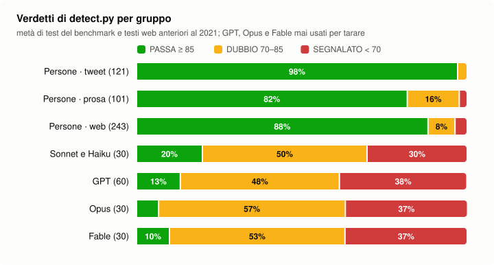

# umanizza · validazione completa

Resoconto di tutte le misure, nell'ordine in cui sono state fatte, comprese le prove che non sono entrate nella skill. Il riassunto è nel [README](../README.md#validazione); la cronologia delle modifiche in [CHANGELOG.md](../CHANGELOG.md).


## Benchmark generico

- **Testo umano:** 444 campioni di italiano scritto prima della diffusione dei modelli linguistici, dai treebank Universal Dependencies: 242 tweet del 2011-2015 (PoSTWITA, TWITTIRO) e 202 brani da giornali, Wikipedia e testi normativi (ISDT, VIT). Le licenze non ne consentono la ridistribuzione: `bench/prepara_umano.py` li scarica e li prepara.
- **Testo generato:** 60 testi di Claude Sonnet e Haiku su 30 consegne comuni (post per LinkedIn e Threads, caption, newsletter, email, articoli, comunicati), richiesti senza alcun riferimento allo slop. Sono in `bench/corpus_ia/`, insieme alle consegne.
- **Metodo:** il corpus è stato diviso in una metà di sviluppo e una di test prima di qualunque analisi. Lessico, pesi e soglie sono stati definiti sulla sola metà di sviluppo. La metà di test è stata eseguita tre volte: alla fine della taratura, dopo la correzione dei difetti segnalati da una revisione indipendente e dopo la revisione di SLOP della versione 1.4.0 (descritta sotto). Pesi e soglie non sono mai cambiati. Tutti i risultati sono in `bench/risultati/`; la cronologia completa è in `CHANGELOG.md`.

Risultati della versione attuale sulla metà di test:

| Gruppo umano | AUC umano/IA | PASSA | DUBBIO | SEGNALATO |
|---|---|---|---|---|
| tweet | **0,99** | 98% | 2% | 0% |
| prosa | **0,91** | 82% | 16% | 2% |

Sui testi generati, nella stessa metà di test: 30% SEGNALATO, 50% DUBBIO, 20% PASSA. L'AUC è la probabilità che un testo umano scelto a caso ottenga un punteggio più alto di un testo generato scelto a caso; 0,50 corrisponde al caso.

<picture>
  <source media="(prefers-color-scheme: dark)" srcset="grafici/verdetti-scuro.svg">
  
</picture>

AUC per controllo (tweet / prosa): CONCRETEZZA 1,00 / 0,88; VOCE 0,80 / 0,78; SLOP 0,70 / 0,63; RITMO 0,57 / 0,47; IMPRONTA 0,50 / 0,50.

Osservazioni principali:

- **La concretezza separa più del lessico.** Le espressioni più note dello slop italiano compaiono in 1 testo generato su 60. Conta di più la scarsità di dati concreti: in mediana 3,7 numeri, nomi, date o strumenti ogni 100 parole nei testi generati, contro 8,7 nella prosa giornalistica (mediane del primo giro).
- **Il valore sui tweet è in parte effetto del genere.** Link, menzioni e nomi propri alzano la concretezza dei tweet umani. Per questo la separazione è stata verificata anche contro testi web dello stesso genere (sotto).
- **IMPRONTA è stato corretto nella versione 1.6.0.** Le lineette usate come inciso compaiono nel 28% dei testi web umani e in 1 testo generato su 90: i modelli attuali le evitano. Prima pesavano contro i testi umani (AUC 0,35 sul web); ora sono riportate ma non tolgono punti, e su testi web nuovi IMPRONTA sale a 0,48. Restano i caratteri invisibili, che arrivano dal copia e incolla. Virgolette curve e puntini di sospensione tipografici, più frequenti nei testi umani, non pesano.
- **Due segnali noti sono stati esclusi.** Le serie di punti esclamativi e le parole in maiuscolo erano più frequenti nei tweet umani che nei testi generati.
- **La pulizia è stata verificata su testo umano.** Una revisione indipendente su 140 testi ha individuato una trentina di casi in cui la pulizia alterava il senso. Ogni caso è diventato un test. Sui 444 testi umani `humanize.py` esegue 9 sostituzioni di lessico, tutte verificate; le altre 62 modifiche sono tipografiche (virgolette curve rese dritte).

Per riprodurre i risultati:

```
python3 bench/prepara_umano.py bench/corpus_umano --dividi
python3 bench/bench.py --ia bench/corpus_ia/test --umano bench/corpus_umano/test/social --umano bench/corpus_umano/test/prosa
```

## Testi web dello stesso genere

Il benchmark confronta generi diversi: i testi umani sono tweet e prosa giornalistica, quelli generati sono post, newsletter, pagine aziendali e comunicati. Per verificare che la separazione non dipenda dal genere, il 26 novembre 2026 umanizza è stato misurato contro testi web italiani scritti prima del 2021, con criteri fissati prima di scaricarli.

- **Fonte:** mC4 italiano (Common Crawl fino al 2020, dataset `allenai/c4` su Hugging Face), due file di validazione da circa 29 MB. I testi non sono inclusi: `bench/prepara_web.py` li scarica e rifà la selezione.
- **Selezione automatica:** nell'ordine del file, senza leggere i testi. Tra 100 e 400 parole, niente avvisi sui cookie né menu ed elenchi. Il genere è ricavato dall'indirizzo della pagina, fino a 50 testi per genere: blog, articoli, pagine aziendali, comunicati, servizi e prodotti. Risultato: 243 testi dal primo file e 242 dal secondo, scritti tra il 2013 e il 2020.

| Testi web umani | contro GPT (60) | contro Claude (30, metà di test) | PASSA / DUBBIO / SEGNALATO |
|---|---|---|---|
| primo campione (243 testi) | **0,91** | **0,92** | 88% / 8% / 3% |
| secondo campione, mai usato prima (242 testi) | **0,90** | **0,91** | 84% / 12% / 4% |

Numeri della versione 1.6.0. Il primo campione è servito anche a trovare il difetto di IMPRONTA; il secondo, da un altro file dello stesso dataset e senza pagine in comune, è servito a verificare la correzione. Per genere, nel primo campione e contro GPT, l'AUC va da 0,90 (pagine aziendali) a 0,91 (le altre). Il criterio fissato in anticipo (AUC ≥ 0,80 contro GPT) è soddisfatto: la separazione regge a parità di genere. CONCRETEZZA resta il controllo che separa di più (0,92 contro GPT), seguito da RITMO (0,77). Limiti: i testi web sono più lunghi (mediana 260 parole contro 110 dei testi GPT) e il genere è stimato dall'indirizzo.

```
python3 bench/prepara_web.py bench/corpus_web
python3 bench/prepara_web.py bench/corpus_web2 --shard 1
python3 bench/bench.py --ia bench/corpus_gpt --umano bench/corpus_web
python3 bench/bench.py --ia bench/corpus_gpt --umano bench/corpus_web2
```

## Testi di GPT

Verifica del 26 novembre 2026, con criteri fissati prima della generazione. Le stesse 30 consegne del benchmark sono state scritte da due modelli di OpenAI tramite Codex CLI (gpt-6.2-sol e gpt-6-luna), con un prompt equivalente a quello usato per Claude e senza alcun riferimento allo slop: 60 testi, in `bench/corpus_gpt/`. Lessico, pesi e soglie non sono stati modificati. Il confronto è con la stessa metà di test dei testi umani.

| | Claude (30) | GPT (60) |
|---|---|---|
| AUC tweet | 0,99 | 0,98 |
| AUC prosa | 0,91 | 0,90 |
| PASSA / DUBBIO / SEGNALATO | 20% / 50% / 30% | 13% / 48% / 38% |

AUC per controllo in prosa (Claude / GPT): CONCRETEZZA 0,88 / 0,86; VOCE 0,78 / 0,71; RITMO 0,47 / 0,61; SLOP 0,63 / 0,60; IMPRONTA 0,50 / 0,50. Per modello, AUC in prosa: gpt-6.2-sol 0,88, gpt-6-luna 0,93.

Il criterio fissato in anticipo (AUC in prosa ≥ 0,85) è soddisfatto: 0,898 con il lessico della 1.3, 0,904 dopo la revisione di SLOP. Limite: i testi sono stati scritti all'interno di Codex, un agente per sviluppatori, e lo stile può differire da quello di ChatGPT. Gemini e gli altri modelli non sono stati misurati.

```
python3 bench/bench.py --ia bench/corpus_gpt --umano bench/corpus_umano/test/social --umano bench/corpus_umano/test/prosa
```

## Modelli Claude più forti

Verifica del 26 novembre 2026, con criteri fissati prima della generazione: le 30 consegne del benchmark scritte da Claude Opus 5.5 e da Claude Fable 5.2, 60 testi in `bench/corpus_claude_forti/`. Ogni testo viene da una sessione nuova, senza strumenti, skill, impostazioni né memoria, con lo stesso prompt usato per GPT. Lessico, pesi e soglie non sono stati modificati.

| Testi umani contro | Prosa | Tweet | Testi web (secondo campione) | PASSA / DUBBIO / SEGNALATO |
|---|---|---|---|---|
| Claude Opus 5.5 (30) | **0,94** | 0,99 | 0,93 | 7% / 57% / 37% |
| Claude Fable 5.2 (30) | **0,94** | 0,99 | 0,93 | 10% / 53% / 37% |
| Claude Sonnet e Haiku (30, metà di test) | 0,91 | 0,99 | 0,91 | 20% / 50% / 30% |

I modelli più forti si riconoscono meglio, non peggio: separano soprattutto le strutture ricorrenti (VOCE 0,89 per Opus e 0,93 per Fable, in prosa) e il lessico (SLOP 0,76 e 0,75). Criterio fissato in anticipo (AUC in prosa ≥ 0,85) soddisfatto per entrambi. Limite: i loro testi sono più lunghi (mediana 280 parole, contro 176 della prosa umana).

## Revisione di SLOP (1.4.0)

Sui dati di sviluppo 16 voci del lessico compaiono nei testi umani almeno quanto in Claude: soprattutto connettivi e formule di registro formale («inoltre», «tuttavia», «pertanto», «qualora», «per quanto riguarda»). La regola, fissata prima del conteggio, le esclude dal punteggio: `humanize.py` continua a segnalarle e a sostituirle come prima (0 differenze su 565 testi). La verifica è stata fatta sui testi GPT, mai usati per tarare, con criteri fissati in anticipo:

| Testi GPT, prosa | Prima | Dopo |
|---|---|---|
| AUC del controllo SLOP | 0,540 | 0,601 |
| AUC del punteggio totale | 0,898 | 0,904 |
| prosa umana con PASSA | 80,2% | 82,2% |

## Lettura alla cieca: la riscrittura si legge meglio?

Prova del 26 novembre 2026, con criteri fissati prima delle riscritture (`bench/lettura-cieca/preregistrazione.md`).

- **Testi:** 10 testi di Claude (metà di test) e 10 di GPT, su 20 consegne diverse.
- **Riscrittura:** con umanizza, da un agente Claude per i testi di Claude e da Codex (GPT) per quelli di GPT, senza aggiungere dati.
- **Lettura:** due lettori che non conoscono umanizza, un agente Claude e GPT tramite Codex, hanno giudicato tutte le 20 coppie originale/riscritto senza sapere quale fosse quale. L'ordine A/B era bilanciato (originale in A in 10 coppie). Domande: quale si legge meglio, quale sembra scritto da una persona.
- **Misura principale:** il giudizio incrociato, in cui ogni riscrittura è giudicata dal modello che non l'ha fatta.

| | Si legge meglio | Sembra scritto da una persona |
|---|---|---|
| Giudizio incrociato (20 coppie) | 12 su 20 | 16,5 su 20 |
| Riscritture di Claude, entrambi i lettori | 8 su 10 | 9-9,5 su 10 |
| Riscritture di Codex, entrambi i lettori | 4-5 su 10 | 7-9 su 10 |

Esito secondo i criteri fissati: **incerto** sulla leggibilità (soglia di successo 14 su 20), netto sull'aspetto umano. Le riscritture di Claude sono preferite da entrambi i lettori; quelle di Codex rendono il testo meno riconoscibile come generato ma non lo rendono più leggibile. Nessuna delle 20 riscritture ha perso o aggiunto numeri, nomi o citazioni. I lettori sono modelli: una lettura fatta da persone resta da fare. Coppie, chiave e risposte sono in `bench/lettura-cieca/`; `python3 bench/lettura-cieca/conta.py` rifà il conteggio.

## Seconda prova: riscrivere meno aiuta Codex?

Nella prima prova Codex cambiava in mediana il 43% delle parole, Claude il 23%. Ipotesi: Codex va peggio perché riscrive troppo. Per verificarla `SKILL.md` è stato reso più restrittivo (solo le frasi segnalate, sotto il 30%) e la prova è stata ripetuta su 20 testi nuovi, con criteri fissati prima (`bench/lettura-cieca-2/preregistrazione.md`).

| | Parole cambiate (mediana) | Si legge meglio | Sembra di una persona |
|---|---|---|---|
| Codex, prima prova | 43% | 4-5 su 10 | 7-9 su 10 |
| Codex, regola più restrittiva | 14% | 3 su 10 | 4-4,5 su 10 |
| Claude, prima prova | 23% | 8 su 10 | 9-9,5 su 10 |
| Claude, regola più restrittiva | 6% | 6,5-7,5 su 10 | 7-7,5 su 10 |

L'ipotesi è smentita: Codex riscrive molto meno, ma le sue riscritture continuano a non leggersi meglio dell'originale. Secondo i motivi dei lettori il problema è come riscrive (frasi spezzate, riformulazioni goffe), non quanto. Con la regola più restrittiva anche l'effetto sull'aspetto umano si riduce. La modifica a `SKILL.md` è stata quindi tolta, come stabilito prima della prova. Le quattro coppie in cui la skill non aveva trovato niente da cambiare (testi identici) hanno avuto pari da entrambi i lettori.

## Terza prova: regole di riscrittura nuove

Dai motivi dei lettori nelle prime due prove sono nate tre regole: tenere i legami tra le frasi invece di spezzarle, rispettare le convenzioni del genere (l'aggancio di un post, la domanda ai lettori, l'elenco che si scorre al volo), non appiattire il testo. La prova è stata ripetuta su 20 testi nuovi, con criteri fissati prima e una condizione aggiunta dal proprietario del progetto: se la media dei due riscrittori peggiora, le regole non si applicano (`bench/lettura-cieca-3/preregistrazione.md`).

| Si legge meglio | Prima prova | Terza prova |
|---|---|---|
| Riscritture di Claude | 8 su 10 | **9-10 su 10** |
| Riscritture di Codex | 4-5 su 10 | **0-4 su 10** |
| Giudizio incrociato, media dei due | 12 su 20 | 10 su 20 |

Le regole rendono quasi perfette le riscritture di Claude e peggiorano quelle di Codex, che continua a spezzare i periodi e ad accorciare troppo. La media scende, quindi le regole non sono entrate nella skill. Nella terza prova una riscrittura di Codex ha perso un'espressione tra virgolette; tutte le altre hanno conservato i fatti.

## Quarta prova: modifiche puntuali con verifica alla cieca

Nelle prime tre prove Codex rileggeva il report e riscriveva il testo intero da capo. La quarta prova ha cambiato il metodo: la riscrittura diventa un elenco di modifiche puntuali, applicate da uno script, e ogni modifica viene confrontata alla cieca con l'originale da chi riscrive, che tiene solo quelle che preferisce. Insieme sono tornate le regole della terza prova. Criteri fissati prima, con la stessa condizione sulla media (`bench/lettura-cieca-4/`, dove c'è anche la versione sperimentale della skill).

| Si legge meglio | Prima prova | Quarta prova |
|---|---|---|
| Riscritture di Codex | 4-5 su 10 | **5-8 su 10** |
| Riscritture di Claude | 8 su 10 | **6-7,5 su 10** |
| Giudizio incrociato, media dei due | 12 su 20 | 11 su 20 |

Il metodo migliora Codex, che non riscrive più il testo intero, e frena Claude, che cambia pochissimo (il 6% delle parole in mediana). La media incrociata scende di una coppia: secondo i criteri il metodo non è entrato nella skill. Tutte le 40 risposte danno invece il valore più alto delle quattro prove (26,5 su 40). Con 10 coppie per gruppo e lettori modello, differenze di una o due coppie sono nel rumore: per decidere tra questi metodi servono campioni più grandi o lettori umani.

## Braccio 4b: Claude riscrive testi di GPT

Nelle prime quattro prove chi riscrive e chi ha scritto il testo coincidono sempre: Claude riscrive testi di Claude, Codex testi di GPT. Il braccio 4b prova il caso che mancava, con criteri fissati prima (`bench/lettura-cieca-4b/preregistrazione.md`): 10 testi di GPT mai riscritti, riscritti da un agente Claude con la skill sperimentale della quarta prova.

| | Si legge meglio | Sembra di una persona |
|---|---|---|
| Lettore GPT (criterio: almeno 7 su 10) | 5 su 10 | 7,5 su 10 |
| Lettore Claude | 6 su 10 | 8 su 10 |

Esito: **incerto**. Due coppie su dieci sono di fatto identiche, perché il report non segnalava nulla. Il testo più riscritto (20% delle parole) perde per tutti e due i lettori. Dalla prova sono uscite due correzioni agli script: la lineetta dopo luogo e data nei comunicati e un falso allarme del controllo di fedeltà sugli apostrofi.

## Quinta prova: riscrive solo Claude

Ipotesi: togliere la riscrittura a Codex e lasciarla a Claude, anche per i testi di GPT. Due bracci sugli stessi 20 testi (10 di Claude mai riscritti, 10 di GPT generati per la prova su consegne nuove), riscrittore sempre Claude: A con le regole della 1.6.0, B con le regole della terza prova. Criteri fissati prima (`bench/lettura-cieca-5/preregistrazione.md`): entra B solo se supera A di almeno 3 risposte su 40; la strada si applica se il braccio scelto arriva ad almeno 25 su 40, il valore della prima prova.

| Si legge meglio | Regole 1.6.0 | Regole della terza prova |
|---|---|---|
| Tutte le 40 risposte | 18 su 40 | 21,5 su 40 |
| Testi di Claude | 13 su 20 | 13 su 20 |
| Testi di GPT | 5 su 20 | 8,5 su 20 |
| Sembra di una persona (40 risposte) | 33 su 40 | 31 su 40 |

Esito: **non si applica**. Sui testi di GPT i lettori preferiscono l'originale anche quando riscrive Claude, e sui testi di Claude il 19 su 20 della terza prova non si ripete. Le riscritture sembrano più scritte da una persona ma non si leggono meglio. Fedeltà: 20 riscritture su 20 in tutti e due i bracci.

## Sesta prova: riscrittura guidata da un profilo di genere

Ipotesi: dare alla riscrittura le misure dei testi umani dello stesso genere (lunghezza delle frasi, punteggiatura, persona, aperture), ricavate dal primo campione web, e far correggere gli scarti. Due bracci sugli stessi 20 testi di Claude Opus e Fable (articoli di blog, pagine aziendali, comunicati, pagine di servizio): A con la skill 1.6.0, P con in più il confronto con il profilo. Criteri fissati prima (`bench/lettura-cieca-6/preregistrazione.md`): il profilo si propone solo se P supera A di almeno 3 risposte su 40.

| | Skill 1.6.0 | Con il profilo di genere |
|---|---|---|
| Si legge meglio (40 risposte) | 28,5 su 40 | 19 su 40 |
| Sembra di una persona (40 risposte) | 39,5 su 40 | 35,5 su 40 |
| Vicinanza al profilo, mediana | da 80,6 a 80,8 | da 80,6 a 84,4 |

Esito: **il profilo non si propone**. Avvicina le misure a quelle dei testi umani e peggiora la lettura: per seguirlo le domande dirette diventano indirette e il «tu» al cliente diventa «il cliente», e i lettori citano proprio queste modifiche. Lo script e i profili non sono nel repo. Un dato a margine, non previsto dai criteri: su questi testi lunghi la skill 1.6.0 ottiene il valore più alto di tutte le prove. Non entra nell'indice, perché i testi sono solo di Claude e riscrive solo Claude.

## Detector esterni: due casi

umanizza non è fatta per i detector e non li chiama. Due riscritture sono state passate a mano su due detector, per vedere cosa succede: sono due casi, non una misura.

| Testo | detect.py dopo la riscrittura | Detector | Originale | Riscritto |
|---|---|---|---|---|
| Email a un cliente, 167 parole (prima prova, c03) | 86,0 PASSA | Pangram 4.1 | non misurato | IA 100% |
| Articolo di blog, 672 parole (sesta prova, o02) | 87,2 PASSA | GPTZero 4.2m | IA 100% | IA 100% |

PASSA dice che il testo non ha più i segni che umanizza conosce, non che un detector lo scambierà per umano. GPTZero dichiara di supportare anche l'italiano; la misura è stata fatta dal sito, senza account, con il selettore della lingua su inglese.

## Classificatore addestrato: si replicano i detector seri?

I detector commerciali più solidi, come Pangram, sono classificatori neurali addestrati su coppie di testi umani e generati sullo stesso tema. La prova ne costruisce una versione piccola, con criteri fissati prima (`bench/classificatore/preregistrazione.md`), per capire quanto del loro comportamento si replica e quanto no.

- **Addestramento:** 465 testi umani di sviluppo (il primo campione web e la metà di sviluppo del benchmark UD) e 465 gemelli generati sullo stesso argomento e della stessa lunghezza da Claude Haiku, Claude Sonnet e due modelli GPT. Un BERT italiano (`dbmdz/bert-base-italian-xxl-cased`), 3 epoche, impostazioni fissate prima. Stessa normalizzazione per tutti i testi, perché il modello non impari la forma della pagina (markdown, a capo, virgolette curve).
- **Verifica:** gli stessi testi dei 12 confronti dell'indice. Opus e Fable non sono mai visti in addestramento.
- **Correzione prima della corsa:** una prova parziale ha mostrato che la consegna dei tweet era ambigua («uno per riga di circa N parole») e che 10 risposte erano rifiuti. I gemelli dei tweet sono stati rigenerati e i rifiuti ritentati, con la correzione scritta nella pre-registrazione.

| Sui 12 confronti dell'indice | `detect.py` | TF-IDF (base) | Classificatore |
|---|---|---|---|
| AUC media | 0,943 | 0,977 | **0,991** |
| AUC minima | 0,896 | 0,925 | 0,963 |
| Testi generati riconosciuti a soglia 0,5 (su 150) | | 139 | 149 |
| Testi umani giudicati generati a soglia 0,5 (su 464) | 12 SEGNALATI | 48 | **32 (6,9%)** |

Esito secondo i criteri: **regge in parte**. Riconosce meglio di `detect.py` (criterio: AUC media almeno pari, nessun confronto sotto 0,85), ma accusa il 6,9% dei testi umani (criterio: al massimo il 3%).

Altri risultati, senza criterio:

- **Tesi**: AUC 0,999 su 30 estratti umani e 30 gemelli di Claude, dove `detect.py` si ferma a 0,52; una tesi umana su 30 sopra 0,5.
- **Riscritture di umanizza**: nelle nove letture alla cieca la probabilità mediana è 0,9995 prima e 0,9995 dopo. Nessun testo riscritto scende sotto 0,5.
- **Casi esterni**: 0,999 sugli originali e sulle riscritture passati a Pangram e GPTZero, che li davano IA al 100%.
- **Combinato con `detect.py`** (media dei ranghi): 0,989, non meglio del classificatore da solo.
- **Testi umani accusati**: pagine commerciali del web, prosa formale e tradotta (economia, trattati europei, Wikipedia), due serie di tweet.

### Prova di conferma con soglia 0,99

A posteriori, una soglia di 0,99 avrebbe accusato solo il 2,8% dei testi umani. Una soglia scelta guardando i risultati non vale, quindi è stata provata su testi nuovi, con criteri fissati prima (`bench/classificatore/conferma.md`): il terzo campione web (231 pagine), 31 brani di prosa giuridica e tradotta (UD ParTUT), 50 testi generati nuovi (Sonnet, Opus e due GPT). Il modello, riaddestrato con le stesse impostazioni, ha dato di nuovo AUC 0,991.

| Testi nuovi | Soglia 0,5 | Soglia 0,99 | Criterio |
|---|---|---|---|
| Umani giudicati generati (262) | 38 | **15 (5,7%)** | al massimo 3%: no |
| di cui pagine web (231) | 28 | 8 | |
| di cui prosa giuridica e tradotta (31) | 10 | 7 | |
| Generati riconosciuti (50) | 50 | **48 (96%)** | almeno 85%: sì |

Esito: **non regge**. La soglia alta riduce le accuse senza perdere quasi nulla del generato, ma non le porta sotto il 3%. Un difetto dei dati, scoperto dopo: ParTUT condivide documenti con la prosa del benchmark, e solo 8 dei 31 brani erano davvero nuovi. Togliendo gli altri, o guardando solo il web, le accuse restano sopra il 3% (3,8% e 3,5%): l'esito non cambia.

### Le soglie di umanizza sugli stessi testi

Misura fatta dopo, non pre-registrata (`bench/classificatore/script/confronto_detect.py`).

| Testi nuovi della conferma | Umani accusati (262) | di cui prosa giuridica e tradotta (31) | Generati presi (50) |
|---|---|---|---|
| umanizza, SEGNALATO | **6 (2,3%)** | **0** | 14 |
| umanizza, SEGNALATO o DUBBIO | 47 | 17 | 35 |
| Classificatore, soglia 0,99 | 15 (5,7%) | 7 | 48 |
| Classificatore, soglia 0,5 | 38 (14,5%) | 10 | 50 |

SEGNALATO è la soglia che accusa meno persone fra quelle misurate, e non ha accusato nessun brano di prosa formale. Il prezzo è che prende pochi testi generati: è una scelta, perché umanizza preferisce lasciar passare un testo generato piuttosto che accusare una persona. I testi incerti finiscono in DUBBIO, che chiede di rileggere e non accusa; sulla prosa formale DUBBIO è frequente (17 brani su 31).

## Limiti dei detector

Quello che abbiamo misurato coincide con la letteratura. I detector riconoscono bene il testo generato, anche dopo una riscrittura leggera, e sbagliano sul testo umano formale, tradotto o di un genere che non hanno visto. Un «IA» su un testo davvero generato è attendibile; un «IA» su un testo umano formale non prova nulla.

- **Fuori dal proprio dominio crollano o accusano.** Il miglior detector di MAGE classifica come generato il 61,95% dei testi umani di domini mai visti ([Li et al.](https://arxiv.org/abs/2305.13242)). Nel benchmark RAID ZeroGPT non scende sotto il 16,9% di falsi positivi, e gli autori sono contrari all'uso disciplinare dei detector ([RAID](https://arxiv.org/abs/2405.07940)).
- **La prosa formale e chi non scrive nella propria lingua sono i più accusati.** Sette detector classificavano come generato in media il 61,22% dei saggi TOEFL di non madrelingua ([Liang et al.](https://arxiv.org/abs/2304.02819)). Su 1.163 tesi magistrali reali di un ateneo belga Pangram ne segnala il 45,5%, senza che si sappia come sono state scritte (studio letto tramite sintesi; [Van Vlasselaer et al.](https://link.springer.com/article/10.1007/s40979-026-00226-w)).
- **I migliori resistono agli humanizer.** Una guida che toglie i segni noti fa scendere GPTZero al 46,7%, ma Pangram resta al 90% ([Russell et al.](https://arxiv.org/abs/2501.15654)). Sui testi accademici umanizzati Pangram resta al 95,74% ([DAMAGE](https://arxiv.org/abs/2501.03437)). Gli 11 humanizer commerciali di uno studio cambiano o tolgono numeri, date, nomi o citazioni nel 35-65% dei documenti ([Wang, Zhu, Chen](https://arxiv.org/abs/2611.00359)).
- **In italiano sono poco verificati.** L'unica prova indipendente ampia riguarda notizie e modelli aperti: Pangram vi arriva all'88,9% con zero falsi positivi, e il riconoscimento scende a circa il 50% sui modelli addestrati da zero in italiano ([DeSegMa-IT](https://ceur-ws.org/Vol-4195/59.pdf)). Turnitin non supporta l'italiano. Nessun dataset pubblico contiene tesi italiane o testi di Claude.
- **Un punteggio è una stima, non una prova.** I numeri dei produttori sono quasi sempre interni, senza verifica di terzi; i benchmark indipendenti sono in inglese.

## Testi accademici

Misura del 23 novembre 2026 su 30 estratti di tesi di laurea e articoli accademici scritti da persone prima del 2022 (licenze Creative Commons, non inclusi nel repository), confrontati con 30 brani di Claude sugli stessi argomenti:

| Misura | AUC umano/IA |
|---|---|
| punteggio totale, modalità accademica | **0,52** |
| CONCRETEZZA | 0,63 |
| VOCE | 0,62 |
| RITMO | 0,37 |
| SLOP | 0,13 |

In questo genere il punteggio non distingue i testi umani da quelli generati: passa il 57% dei testi umani e il 53% di quelli di Claude. Due controlli invertono la tendenza. Nei testi accademici umani connettivi come «inoltre», «tuttavia» e «infatti» sono più frequenti che in Claude, e Claude varia la lunghezza delle frasi più degli autori umani. Per questo in modalità accademica `detect.py` lo dichiara nel report e non applica soglie specifiche per il genere. Una correzione di SLOP per questo genere è stata misurata e scartata (vedi `CHANGELOG.md`, versione 1.3.1).

La mappa delle frasi (`--mappa`) segnala quattro costrutti che in inglese distinguono i modelli: gerundio dopo la virgola, nominalizzazioni, connettivo in apertura, «È importante che». Nel test fissato in anticipo, sui testi del benchmark separa solo con le nominalizzazioni (AUC 0,70); nei testi accademici gerundi e connettivi in apertura sono più frequenti negli autori umani. Per questo resta marcata come sperimentale.
